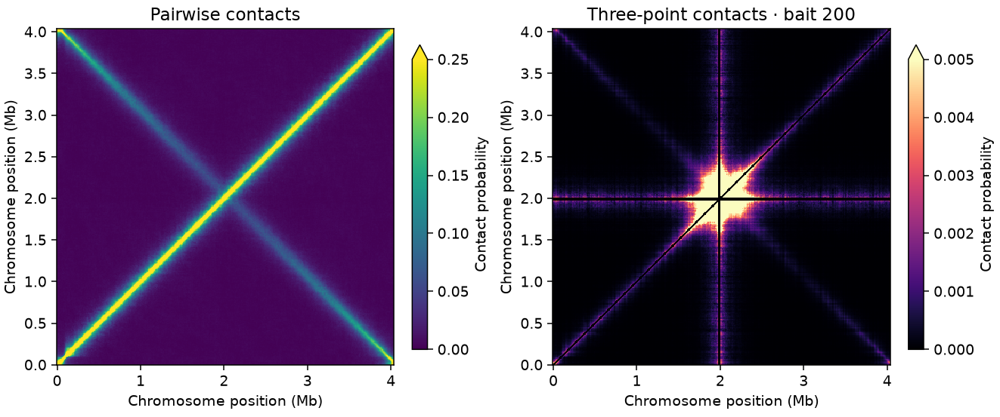
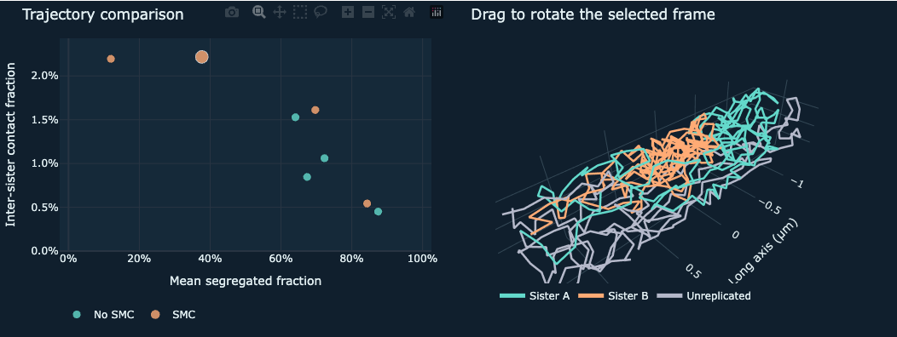

# Chromosome contacts on ADA

Open the [demo notebook](notebooks/demo.ipynb) in your running [Open OnDemand JupyterLab session](https://ondemand.labs.vu.nl) and choose **Run All Cells**. The bait-200 map opens inside the session. New segregation calculations can run as short Slurm jobs on a separate GPU node. If CPU batch nodes lack Julia, run `bash scripts/stage-julia.sh` once in the shared ADA clone to make the tested runtime available.

## Restore the full ADA demo

From the shared clone in the OnDemand Apptainer terminal, run the following. This prepares both the **603-trajectory H200 comparison** and the **2,020-locus, 60-thread CPU benchmark**. Omit `--with-bait` to prepare only the segregation dataset.

```sh
git pull --ff-only origin main
export PATH="$HOME/.local/bin:$PATH"
uv sync --locked --extra lab --extra segregation --extra cuda12 --extra extract
.venv/bin/python -m demo_storage prepare-ada --with-bait
```

The command recovers existing inputs or fetches the missing originals on ADA. A fresh installation uses the dedicated H200 partition through the ADA login host. After preparation, restart the notebook kernel, run all cells and open **Sister segregation → Compare stage** for a live 90% comparison. Open **Live experiment → Run experiment** for the largest prepared CPU benchmark.

To clear saved stage answers, run `.venv/bin/python -m demo_storage clear-cache`. Prepared datasets live under `inputs/`, Julia under `runtime/`, and scheduler settings in `slurm.toml`. On older clones, run preparation once to preserve those assets before clearing `results/`. [Storage and recovery details](docs/segregation.md#prepare-or-restore-the-full-ensemble)



## Compare sister chromosomes

Select **Sister segregation** to compare matched trajectories from Harju, van Teeseling and Broedersz’s 2024 study. Pick a replication stage, vary the contact radius, and click an outlier to rotate its sister chromosomes in 3-D. Pin it and click another point to compare their segregation histories. The repository includes eight archived trajectories sampled at three stages. On ADA each new stage and contact radius can submit a single H200 job. The job reads that window of the 603-trajectory ensemble, saves the result and exits. Each comparison runs live by default. Enable **Reuse saved comparisons** for immediate replay. The guide includes an eight-trajectory GPU smoke test you can run before staging the full archive. [H200 setup and presentation guide](docs/segregation.md) · [Paper](https://doi.org/10.1038/s41467-024-49039-w)



## Present the bait-200 experiment

1. **Chromosome map.** Start at bait 200 and move it to 100. The left panel shows measured pair-contact frequencies from condensin simulations. The right panel predicts where two other chromosome regions meet the bait. Switch between 40, 20 and 10 kb spacing to see how much detail finer sampling reveals.
2. **Live experiment.** A configured Slurm session opens on the largest prepared resolution and CPU ceiling. **Run experiment** measures that thread count immediately. For a comparison, choose **Compare with 16 threads** at a ceiling of 60. One CPU allocation measures 60 first and then 16 on the same input. **Thread sweep** and **Resolution ladder** are available for a longer scaling study. [Prepare the 2,020-locus input](docs/high-memory.md)
3. **Watch a worker.** One Julia process runs per configuration. Read its PID, requested compute threads, busy CPU equivalents, share of the worker’s CPU allocation, resident memory and completed predictions. The plots update continuously. On Linux the busiest OS threads have individual CPU meters. Compare the one-thread and multi-thread phases. **Stop** ends the active worker and retains completed measurements.
4. **Results & replay.** Compare median time per prediction, throughput, speedup, efficiency, average busy CPUs and peak resident memory on the measured node. Scrub the recorded samples to revisit worker activity, or open the saved bait plane to inspect the scientific output. Results persist in shared project storage under `results/session-*/`.

| Loci | Genomic spacing | Entries predicted per pass | Dense output |
| ---: | ---: | ---: | ---: |
| 101 | 40 kb | 1,030,301 | 7.86 MiB |
| 202 | 20 kb | 8,242,408 | 62.88 MiB |
| 404 | 10 kb | 65,939,264 | 503.08 MiB |
| 1,010 | 4 kb | 1,030,301,000 | 7.68 GiB |
| 2,020 | 2 kb | 8,242,408,000 | 61.41 GiB |

All resolutions cover the same circular chromosome. The three coarsest are bundled. The 2 kb map is prepared by `prepare-ada --with-bait`, and the 4 kb map is optional. Doubling the genomic resolution multiplies the number of triplet entries by eight. Each timed pass fills a real probability tensor. The benchmark repeats complete predictions for the selected window and reports how many it finished.

## Get the repository

From a terminal in your allocated session:

```sh
git clone https://github.com/Kostusas/ada-beta-demo.git
cd ada-beta-demo
```

Open `notebooks/demo.ipynb` in the JupyterLab file browser. The tested runtime is Julia 1.12.6 on PATH, with Python 3.11–3.14, NumPy, Matplotlib, ipywidgets and psutil. To reproduce the Python environment on another installation, the repository includes a uv lockfile. If your existing kernel needs those packages, register the locked kernel once from the clone:

```sh
uv sync --locked --extra lab --extra segregation
.venv/bin/python -m ipykernel install --user --name ada-contacts --display-name "ADA chromosome contacts"
```

Select **ADA chromosome contacts** and run the notebook. The standard OnDemand JupyterLab app is sufficient. [VU Open OnDemand guide](https://rdm.vu.nl/tools/ada/open-ondemand.html)

## Go beyond the published resolution

The notebook also discovers 1,010- and 2,020-locus contact maps prepared from the original trajectory coordinates. Their dense predictions occupy 7.68 and 61.41 GiB respectively, plus process overhead. Prepare the desired map once on the cluster, rerun the notebook cell, and choose **Slurm CPU allocation** for the prediction. [High-memory walkthrough](docs/high-memory.md)

## Scientific source and verification

The predictor and input map come from Harju, Messelink and Broedersz, *Multicontact statistics distinguish models of chromosome organization* (2025). The 101-locus stage compares all entries to the original serial implementation. At 404 loci every configuration checks the published-resolution bait-200 plane. Full-cube hashes check agreement across thread counts for each standard resolution. The larger inputs use a sampled serial check. [Paper](https://doi.org/10.1103/PhysRevE.111.014403) · [Methods and file formats](docs/method.md) · [Upstream repository](https://github.com/PLSysGitHub/chromosomal_multi_contact_data)

The demo code is MIT licensed. The segregation preview uses the archive’s CC BY 4.0 license. [Preview provenance and data license](data/segregation-preview/README.md)

The original predictor and contact data retain the authors’ notice. [Project license](LICENSE) · [Upstream license](src/upstream/LICENSE)
